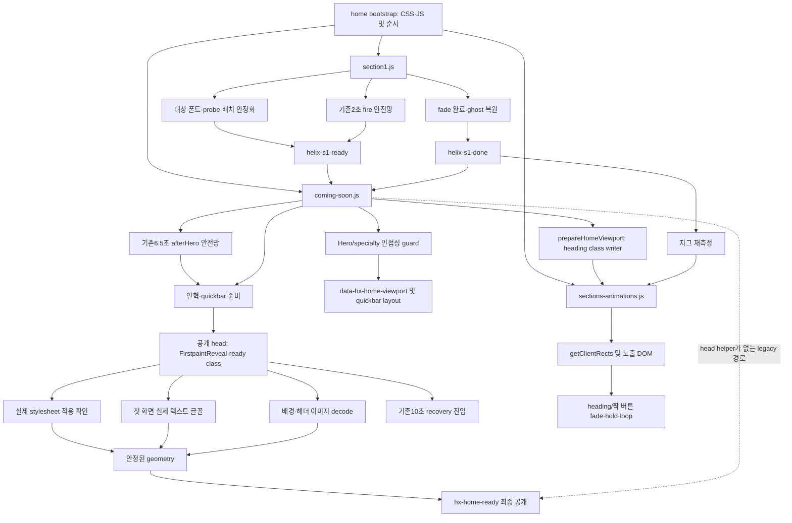

# HELIX D03/D07 — Firstpaint/Hero 및 heading 소비자 경계

2026-11-18 KST. 시작 HEAD74bf6b2, 기존 동결52a31c8 및 E1/P3·앞선 모든 제품을 보존한다. 작업장 clean·GitHub HEAD일치, main3c4f78d4/staginga074f455 동일을 확인했다. AGENTS/관련CLAUDE/HANDOFF/14와 성능 스킬의 표준·최신Drive 인계를 읽었다. Drive의 STEP04 당시 중단 표기보다 현재 사용자와 최신GitHub 실행 기준을 우선한다. 이미 승인된 조사/국소 구현/검증/복구/문서/작업 브랜치 전달을 진행하며 공개 설정/게시/병합은 하지 않는다.

## 최종 판정 — 제목 소비자 경계 개선 완료 / D03·D07 전체는 미완료

동결 소스·검사 **c2a0b3492dbc998fe88acf4d071f270ec88cfe75**의 새 clone에서 **22단계를 단일 연속 실행해 모두 통과**했다. 기존21단계를 보존하고 새 firstpaint24쌍을 같은 실행에 포함했다. 이전 성공, 수집 진단, 사전 검사 또는 실패 실행의 일부를 합산하지 않았다. 이후 전달은 문서·증거만 변경한다. [최종 대장](evidence/firstpaint-final.json)이 source/tests·입력·실패·복구·URL/SHA의 판정 근거다.

**제거한 의존성은 ‘앞선 숨은 제목 하나가 실제 보이는 제목의 hook/짝 버튼 초기화를 결정하는 관계’다.** 제품d443254는 Home의 세 selector에 속한 제목 소비자를 모두 마킹한다. 실제 노출과 첫 fade·hold·loop는 기존 heading lifecycle이 계속 소유한다. Hero 인접성 guard, 공개 head의 firstpaint 함수/ready class, CSS·폰트 준비 순서와 기존 효과는 바꾸지 않았다. 새 전역 timer·observer·retry 계층이나 runtime 파일도 없다. 제품 diff는 coming-soon.js 한 파일 +5/-2이며 기존 E1/P3 및 완료 소스는 보존했다.

| 구분 | 실제 검증 결과 |
| --- | --- |
| 선택한 원인 | 숨은h2 복제는 단면 배치를 바꾸지 않지만 원본의 실제제목 hook0/짝버튼 opacity0을 만든다. 후보는 실제제목3개 마킹·노출 후 버튼1/loop로 복구했다. 게시 HTML에 이 복제가 현재 있다는 주장은 아니다 |
| 정상·비대상 보존 | 5페이지×3크기15쌍, 기존1440 시작11경계, CTA gap/border 각각108쌍·36통제, 모션·줄바꿈·기존 로더/메뉴/CTA/폼을 같은 새 소스에서 통과 |
| 새 firstpaint 단위 | 24쌍/48실행. 정상·숨은복제의PC/모바일 각3회,tablet 각1회, 실제Typekit fetch 포함 폰트 지연·criticalCSS/Hero/writer 지연·의존성 실패/복원을 확인했다.3시작 폭에서 원본/후보 각각3회 역전환을 수행했다 |
| 노출·타이포·효과 | 정상·지연 조건의 공개 후 rAF 상태에서 Hero/슬로건 재숨김이나 제목 치수 변동이 없었고 주요 글꼴의 실제 등록/loaded 상태를 확인했다. 정상·지연 조건의 첫 화면 geometry·타이포는 원본/후보 exact였다. 실제 fade 완료→1.5초hold→loop와 반복 진입 보존을 확인했다. PNG는 공개 후 기록이며 물리 고속영상은 아니다 |
| 복구 | 같은 동결 소스의 다른 새 clone에서 실제 원격 역커밋05a3032의hunk를 적용하자 정확히0≠3으로 회귀를 검출했다. 해당hunk만 역적용해 원래SHA/clean으로 복구했다. 별도1px gap4→5도 검출·복구했다 |
| 남은 실제 실패 | 실제Section1 40회 재시도 실패 신호 뒤 GSAP를 복원하면 section은 회복하지만 Hero claimtrue·ready/done0은 남는다. 이 분류 검사 통과는 Hero 복구 성공이 아니다. 현재 source에서 이 문제를 해결했다고 선언하지 않는다 |

### 실패·입력·공개 자산 판정

- 첫711ee35 연속 실행은 Typekit 미수록 URL로 중단됐다. 원시 실패와 잘못된 초기 검사 예상, 중복 입력 guard 거절 및 수집 메타데이터 조합 실패를 보존했다. 제품 보정을 쌓거나 허용값을 바꾸지 않았다.
- 신규 폰트20개 URL은 각각 실제 응답으로 확보했다. 같은URL·같은SHA만 중복 저장을 줄이고 모든 관측 출처를 남겼다. 다른URL alias/기존응답 덮어쓰기/동일URL의 상이본문 선택은 없다. 수집 진단은 diagnosticOnly/passfalse이고 최종22단계는 수집기 없는 정적 오프라인 재생이다. 원본8manifest/2,130body도 다시 해시 검증했다.
- 기준PNG33/286응답·mask·100px·threshold0.2·기존expected failure는 그대로다. 정상 PC/모바일3회와 tablet1회의 공개 시각 중앙값·범위는 대장에 기록하되 자체ready 관측값을 LCP나 실제 속도 개선으로 표현하지 않는다.
- 공개10HTML은 앞선 관측과 같고 실제고정CSS/JS9응답은 Git blob과 일치했다. 공개 head의 소유권/코드는 이동하거나 수정하지 않았다. 현재 공개소비자는 작업소비자와 달리 idx기반 매칭을 사용한다. **따라서 이번 커밋 단독 공개 이관·혼합호환성은 미검증**이다. 현재작업소비자의 완료된 lifecycle/숨은DOM필터 계약을 전제로 검증한 단위다.
- `7195463`은 E1/P3/이번D03가 없는 참고 후보다. 기존 staging 제안은 실행하지 않았다. 실제 적용을 추진하려면 당시 최신 공개자산에서 필요한 producer/consumer 단위만 고른 별도 최소패키지와 실제URL·혼합검증이 필요하다. 기존 감사브랜치 전체 병합은 사용하지 않는다.

### 남은 실행 순서와 승격 조건

1. **D03/S1의 실제 실패 복구가 다음 우선 단위다.** 이번에 확보한40회 실패 신호→실제 의존성 복원 입력을 사용해 module 점유와 실제 초기화 완료를 구분한다. 기존폰트·ghost 복원·ready/done·fade/1.5초hold/loop를 보존하면서 한 owner의 책임만 좁힌다. generic guard reset·전역 timer/observer/retry 추가는 하지 않는다. 이 단위를 해결/명시적으로 한정하기 전 D03 전체를 완료로 바꾸지 않는다.
2. 다른 firstpaint·전체section 복제 경계는 추가 진단이다. 첫 전체section 복제 probe는 인접성과 여러 first-match를 함께 바꿔 이번 제목-only 원인과 분리했다. 정상 다중 호출만으로 결함으로 세지 않는다. 공개head/ready 소유권 변경이 필요하면 별도 승인안으로 분리한다.
3. 이후 **D02 다른 label/제목 root → D05 실제 소비 속성** 순서다. 기존 내과/intro/consent와 CTA 완료 속성은 반복하지 않는다. 게시문구/합성입력 구분·원본 실패→후보 복구·비대상5×3 또는108/36 통제가 있어야 제품을 수정한다.
4. **D06은 환경 부족 미검증**이다. WebKit2227 실행파일과 실제Safari/iOS/iPad 환경이 없어 viewport 제품은 그대로다. 실제환경 확보 후 회전·fixed/sticky·메뉴/폼/카드를 확인한다. Chromium 폭 전환으로 대체하지 않는다.
5. 전체 구조 독립 감사는 미완료다. 이번 검증은 새 clone의 자동 재실행이며 별도 사람의 전체 감사가 아니다. D04의 일반 HTTP200 실행 오류·구생산자 조기실패·조용한pending·미래@main 위험도 유지한다. V0의 새 판별 근거가 없어 재개하지 않았고 U01도 보류했다.

복구는 **05a3032의 해당 diff만** 최신 작업본에 적용한다. recovery 브랜치 전체 snapshot으로 대체하지 않는다. main/staging 병합, 공개head·pin·설정 변경, Webflow Publish와 운영 배포는 하지 않았다. 운영 효과·실기기·실제 방문자 성과는 미검증이다.

raw본문·PNG·전체로그·궤적은 `/workspace/artifacts/helix-firstpaint-20261118` **로컬 전용**이다. GitHub에는 source/tests·소유 그래프·판정/핵심SHA·원시대장SHA·복구·수집기 원문을 보존한다. 원격 body archive가 없으므로 다른 머신에서 raw 없이 완전 재생 가능하다고 주장하지 않는다.

아래는 시점별 계획·진단·중간 결과다. 현재 판정은 위 최종 절과 대장을 따른다.

작업량 대, 현재 모델 유지·높은 추론 강도·예상 사용량 높음. 산출물은 실제 소유 그래프/URL·SHA, 단일 원인 재현과 최소 제품, 독립 역커밋, 새 동결 소스의 기존21단계+새검사 연속 검증, 원시증거/인계다. 원시 자료는 새 `/workspace/artifacts/helix-firstpaint-20261118`에 보존하며 이전 raw를 덮지 않는다.

## 실제 책임 그래프

정상 여러 진입은 guard/WeakMap/WeakSet이 구분하며 호출 수만으로 결함으로 보지 않는다. 공개 head의 함수와 최종 ready class 소유권은 이동하지 않는다. prepareHomeViewport의 인접성 guard 전에 hook을 등록한 기존a9626dd는 보존한다. 초기화 claim과 completion, hidden 복제 노드와 실제 노출을 검사에서 분리한다. CSS/폰트 준비나 글로우·divider 알고리즘은 변경 대상이 아니다.

## 상태 소유자와 실제 의미

| 소유자 | 신호·소비자 | 실제 의미 / 보존 경계 |
| --- | --- | --- |
| 공개head | `__hxHomeFirstpaintReveal`·`hx-home-ready` / 첫 화면 공개 | 현재정상 경로의 최종소유자. link stylesheet 전체·실제텍스트폰트·이미지decode·geometry settle를 확인한다.10초는복구진입이지완료약속이아님. 소유권/공개head는미변경 |
| coming-soon | `prepareHomeViewport` / section heading lifecycle | 각root의제목hook writer.마킹≠노출/초기화완료. Hero/specialty 인접성 guard는 별도 viewport/layout 조건으로 유지 |
| coming-soon | local `heroReady` / 연혁·quickbar 후head호출 | ready/done뿐아니라기존6.5초안전망도true를만든다. 실제Hero완료증거로쓰지않음. head함수가없는legacy 분기에서는직접ready class를쓰지만현재공개head함수는존재함 |
| section1 | `__HELIX_SECTION1_LOADED__`·private `started` | 각각module점유/초기시작이고완료가아님. GSAP실패시private시작실패후40회창이끝나도module점유는남음 |
| section1 | `helix-s1-ready` / coming-soon | 정상폰트/probe/배치뒤fire,기존2초안전망도fire가능. head가별도로실제폰트를검증하며이벤트만으로font성공을판정하지않음 |
| section1 | `helix-s1-done` / 지그refresh·coming-soon | 배경/콘텐츠fade뒤ghost복원후신호. 실제실패복원검사에서는이신호0이남음 |
| sections | WeakMap/WeakSet·visible rect / heading·card·지그 | 정상다중진입은단일상태를재사용.실제노출DOM만시작하고숨은복제는보류.기존fade·1.5초hold·loop/resize를보존 |

## 선택한 새 원인과 수정 전 계약

`prepareHomeViewport`는 각 selector의 첫 `h2.home_title`만 마킹한다. 앞선 숨은 제목 복제가 그 첫 노드를 차지하면 다른 섹션의 `.section2-heading` 존재 때문에 sections 초기화의 전역 fallback도 켜지지 않아, 실제 제목의 짝 버튼은 계속 숨는다. 원본74bf6b2,1440에서 정상은 button opacity1/looptrue, **제목 노드만 숨은 복제**한 통제는 실제 제목 hook누락/button opacity0/loopfalse를 재현했다. fixture는 실제h2 복제·display:none이며 게시 콘텐츠에 복제가 있다고 주장하지 않는다.

첫 section전체 복제 probe는 Hero/specialty first-match 인접성까지 함께 바꿨으므로 제품 원인 입증에서 분리했다. 이후 heading-only probe로 Hero 인접성/실제 배치와 독립된 실패를 확인했다. 두 원시 probe와 실패는 모두 보존한다.

최소 후보는 coming-soon.js의 해당3개 section selector에 `querySelectorAll`을 사용해 자기 heading 소비자를 모두 마킹하는 것이다. 마킹은 노출/초기화 완료가 아니며 기존 section lifecycle이 hidden을 제외하고 첫 실제 노출 시에만 fade를 시작한다. 새로운 timer/observer/retry/전역 초기화 계층을 만들지 않는다. 정상 geometry/타이포/firstpaint·Hero events·기존 viewport guard·glow의1.5초hold와 loop를 보존해야 한다. 이 한 원인 외 head책임 이동/임의 복구/전면 재작성은 하지 않는다.

## 검증·중단·복구

원본 실패→후보 통과를 먼저3크기로 확인한다. 새 단위는 cold3크기, PC/모바일 각각3회 쌍비교, 폰트/CSS/Hero/writer 지연, hidden heading, 실제 의존성 실패/복원, 모바일·태블릿 시작 역전환, Hero/heading 노출과 fade/hold/loop를 기록한다. 시간은 자체공개 시각이며 LCP/실사용 성과로 바꾸지 않는다. 정상 첫 화면·메뉴/CTA/폼 및5페이지×3크기는 기존21단계를 유지해 새 동결 소스 단일 연속 검사에서 확인한다. 정상 기준PNG/mask/100px/.2/expected failure는 변경하지 않는다. 새 미해결 실패는 건강 회복으로 승격하지 않는다.

한 원인당 제품/검사 커밋을 분리하고 실제 역커밋을 별도 브랜치에 보존한다.1px 및 자기 원인 역변경을 새 격리 작업본에 주입→검출→자기 hunk 복구하며 기존 원본·다른 작업자는 보존한다. 예기치 않은 실패2회면 덮어쓰기를 멈추고 source/입력/실제소유자부터 재진단한다.

D04 범용실행예외/구생산자/무응답/미래main 위험, D02/D05잔여, D06실엔진 부재 및 V0/U01 보류는 그대로다.719는 E1/P3도 빠진 참고 후보이며 이번 staging 적용안도 실행하지 않는다. 제품 검증 후 D02→D05→실제엔진D06→전체감사의 조건을 재평가하고, 미완료/미검증을 분리한다.

## 개별 결과와 새 증거 — 최종 동결 검사가 우선

제품 **d443254**는 first-match 제목 마킹을 자기 제목 소비자 전체 순회로 바꾼다. 수정 전 red(미수정 후보0≠3) 후3크기3쌍에서 원본 숨은 복제 조건의 버튼0/loop없음→후보 버튼1/loop를 입증했고 첫 화면 geometry/타이포는 exact였다. head·Hero 인접성 guard·폰트·section 애니메이션·기존 완료 소스는 그대로다. 검사 **d4b74d2/a8b7c39**와 제품을 분리했다. 독립 역커밋 **05a303290aebd6b8d3993ceb77086f377b69744e** (`recovery/helix-heading-consumers-20261118`)는 이 hunk만 되돌린다.

공개10HTML은 지난 관측과 모두 같은 bytes이며, 실제 고정CSS/JS 진입 URL9개는200이었다. 실제 응답 SHA와 격리 후보 overlay SHA를 각각actual-assets/head-ownership에 기록했다. 새 코드가 공개 웹사이트에서 전달됐다는 의미가 아니다.

조사 중 검사 문제도 보존했다. 초기 GSAP 실패 조건은 미수록 Typekit order URL을 만들었다. 해당 신규 정확한 URL의 실제200응답을 별도 입력으로 확보했으며 역사적 응답을 최신 bytes/합성 alias로 대체하지 않았다. 또 초기 검사는6초 뒤 Hero와 모든 section이 미복구일 것으로 잘못 예상했다. 실제 관찰과 소스를 재진단하니 각 owner의 재시도 창과 정상 재진입 시점이 달랐다. 제품 보정을 추가하지 않고, **실제 Section1의 `init failed after 40 retries` console 신호**로 실패 지점을 확정한 뒤 같은 실제GSAP URL을 복원하도록 재현을 바꿨다. PC/모바일×원본/후보4실행에서 section은 복구했지만 Hero claim=true·ready/done0은 남았다. firstpaint fallback 공개를 Hero 초기화 완료로 보지 않으며 이 Hero 문제는 미해결이다. 입력 부족·잘못된 초기 검사 예상·6초 관찰은 별도로 보존한다.

새 검사 단위는 실패 전attempt/source SHA, rAF 노출·폰트·ghost/class writer 궤적, 실제 이벤트·원본 PNG, fade/1.5초hold/loop를 기록한다. 기존21단계는 모두 유지하고 이 단위를 추가한 단일22단계로 검증한다. 새 단위는24쌍/48실행: 정상/숨은 복제의PC·모바일 각3회 쌍비교와tablet 각1회, 폰트/CSS/Hero/writer 지연 및 실제 의존성 복원이다.3시작 폭에서 각각 역전환을 확인하고 기존1440 시작11경계 검사도 유지한다. 실제Safari/iOS·물리 고속영상·방문자LCP는 Chromium 검증 완료 범위가 아니다.

## 동결·복구 검증 체크포인트

소스·검사를 **711ee35093d74680bf144982cfceda3070401bab**로 동결한 새clone에서22단계 단일연속 실행을 시작했다. 이전21단계와개별성공을합산하지않는다. 다른새clone에서는실제역커밋05a3032의diff→제목검사0≠3검출→자기hunk복구,1px gap4→5오류검출→복구를통과했고원본byte/clean상태를확인했다. 아직전체통과로판정하지않는다. [체크포인트](evidence/firstpaint-progress.json)는 이시점기록이다.

## 1차 연속 검증 중단 및 입력 재진단

711ee35의 첫22단계는 기존4단계 통과 후 새 firstpaint의Hero-delay 원본에서 미수록Typekit URL5개로 중단했다. 정상/숨은제목PC3회 및폰트·criticalCSS 조건의부분성공은전체통과로합산하지않는다. 제품회귀나기준을고치는대신, 로딩순서에따른Typekit state/chunks 조합을분리해정확한신규URL만실제로수집했다. 별도전체24쌍수집진단과font payload 보완4실행은명시적diagnosticOnly/passfalse이며배포검증결과가아니다.

첫추가입력끼리같은URL이중복돼엄격한corpus guard가거절한실패와, 수집메타데이터시간필드차이로중단한조합도그대로보존했다. 동일URL의동일SHA만중복제거하고모든관측출처를남겨 **신규정확URL20개**의불변입력을구성했다. 서로다른URL을alias로바꾸거나원래응답을최신내용으로대체하지않았다. 기존원시URL과교집합0/동일URL의상이본문0이다.

검사 **5d5247c**는native font타입뿐아니라Typekit `/af/` fetch도지연시켜실제주요폰트를검사하고, 첫화면등록/loaded 상태를추가확인하도록강화했다. 기존21단계·기준PNG/mask/허용값/expected failure는바꾸지않았다. 공개head의기존등록확인·폰트gate는이조건에서도유지됐으며head를수정할필요는이단위에서확인되지않았다. 새로운제품보정은추가하지않았다. 새정적입력으로수집기없는오프라인24쌍을먼저확인한뒤새동결소스의22단계를처음부터재실행한다. 첫연속실패는 `final-continuous`에, 수집·실패·수정된검사원문은새raw내각기다른디렉터리에보존한다.

## 정적 입력 오프라인 재확인과 실제 자산 차이

수집기가 없는엄격한오프라인검사에서새24쌍/48실행을완료했다. 매실행network.forwarded0·미수록/JS오류0, 정상/숨은제목3회반복·폰트/CSS/Hero/writer 지연·실제의존성복원분류를검사했다. 이개별결과는새22단계성공으로합산하지않고입력완전성확인에만쓴다. 원래8개입력과새폰트URL20개를분리했다. 실제폰트payload지연과해당family의등록/loaded 상태가둘다확인됐으며단순FontFaceSet.check true를준비완료로간주하지않았다.

actual-assets의9개CDN본문은모두실제고정commit Git blob과일치했다. 그중7개는작업소스와같고coming-soon/sections-animations는달랐다. **공개main 소비자에는기존idx 기반button매칭이남아있고현재작업소비자에는이미완료된heading lifecycle/숨은DOM필터가있다.** 이번한파일fix는현재작업소비자계약에서검증한것이며공개자산단독이관/혼합호환성을검증한것이아니다. 향후최소적용패키지는실제최신공개자산과필요한소비자계약을별도검사해야하며감사브랜치전체를병합하지않는다.719는E1/P3/새D03를포함하지않는참고후보로유지하고적용하지않는다.

다음동결검사는같은제품d443254와강화검사를새clone에고정해22단계를새출력경로에서연속실행한다. 이전711ee35의실패/진단/오프라인사전검사는각각보존한다. 원격에는수집기/HTTPreader 원문과SHA를남기되폰트본문·PNG·전체로그는로컬전용이다.
