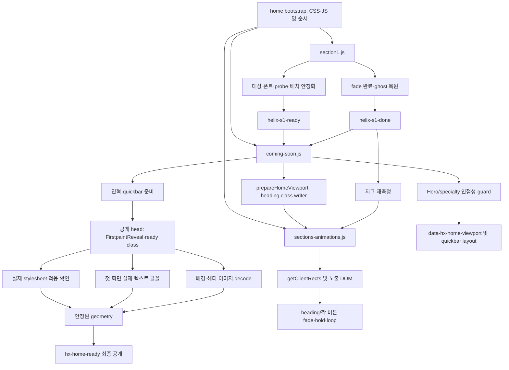

# HELIX D03/D07 — Firstpaint/Hero 및 heading 소비자 경계

2026-11-18 KST. 시작 HEAD74bf6b2, 기존 동결52a31c8 및 E1/P3·앞선 모든 제품을 보존한다. 작업장 clean·GitHub HEAD일치, main3c4f78d4/staginga074f455 동일을 확인했다. AGENTS/관련CLAUDE/HANDOFF/14와 성능 스킬의 표준·최신Drive 인계를 읽었다. Drive의 STEP04 당시 중단 표기보다 현재 사용자와 최신GitHub 실행 기준을 우선한다. 이미 승인된 조사/국소 구현/검증/복구/문서/작업 브랜치 전달을 진행하며 공개 설정/게시/병합은 하지 않는다.

작업량 대, 현재 모델 유지·높은 추론 강도·예상 사용량 높음. 산출물은 실제 소유 그래프/URL·SHA, 단일 원인 재현과 최소 제품, 독립 역커밋, 새 동결 소스의 기존21단계+새검사 연속 검증, 원시증거/인계다. 원시 자료는 새 `/workspace/artifacts/helix-firstpaint-20261118`에 보존하며 이전 raw를 덮지 않는다.

## 실제 책임 그래프

정상 여러 진입은 guard/WeakMap/WeakSet이 구분하며 호출 수만으로 결함으로 보지 않는다. 공개 head의 함수와 최종 ready class 소유권은 이동하지 않는다. prepareHomeViewport의 인접성 guard 전에 hook을 등록한 기존a9626dd는 보존한다. 초기화 claim과 completion, hidden 복제 노드와 실제 노출을 검사에서 분리한다. CSS/폰트 준비나 글로우·divider 알고리즘은 변경 대상이 아니다.

## 선택한 새 원인과 수정 전 계약

`prepareHomeViewport`는 각 selector의 첫 `h2.home_title`만 마킹한다. 앞선 숨은 제목 복제가 그 첫 노드를 차지하면 다른 섹션의 `.section2-heading` 존재 때문에 sections 초기화의 전역 fallback도 켜지지 않아, 실제 제목의 짝 버튼은 계속 숨는다. 원본74bf6b2,1440에서 정상은 button opacity1/looptrue, **제목 노드만 숨은 복제**한 통제는 실제 제목 hook누락/button opacity0/loopfalse를 재현했다. fixture는 실제h2 복제·display:none이며 게시 콘텐츠에 복제가 있다고 주장하지 않는다.

첫 section전체 복제 probe는 Hero/specialty first-match 인접성까지 함께 바꿨으므로 제품 원인 입증에서 분리했다. 이후 heading-only probe로 Hero 인접성/실제 배치와 독립된 실패를 확인했다. 두 원시 probe와 실패는 모두 보존한다.

최소 후보는 coming-soon.js의 해당3개 section selector에 `querySelectorAll`을 사용해 자기 heading 소비자를 모두 마킹하는 것이다. 마킹은 노출/초기화 완료가 아니며 기존 section lifecycle이 hidden을 제외하고 첫 실제 노출 시에만 fade를 시작한다. 새로운 timer/observer/retry/전역 초기화 계층을 만들지 않는다. 정상 geometry/타이포/firstpaint·Hero events·기존 viewport guard·glow의1.5초hold와 loop를 보존해야 한다. 이 한 원인 외 head책임 이동/임의 복구/전면 재작성은 하지 않는다.

## 검증·중단·복구

원본 실패→후보 통과를 먼저3크기로 확인한다. 새 단위는 cold3크기, PC/모바일 각각3회 쌍비교, 폰트/CSS/Hero/writer 지연, hidden heading, 실제 의존성 실패/복원, 모바일·태블릿 시작 역전환, Hero/heading 노출과 fade/hold/loop를 기록한다. 시간은 자체공개 시각이며 LCP/실사용 성과로 바꾸지 않는다. 정상 첫 화면·메뉴/CTA/폼 및5페이지×3크기는 기존21단계를 유지해 새 동결 소스 단일 연속 검사에서 확인한다. 정상 기준PNG/mask/100px/.2/expected failure는 변경하지 않는다. 새 미해결 실패는 건강 회복으로 승격하지 않는다.

한 원인당 제품/검사 커밋을 분리하고 실제 역커밋을 별도 브랜치에 보존한다.1px 및 자기 원인 역변경을 새 격리 작업본에 주입→검출→자기 hunk 복구하며 기존 원본·다른 작업자는 보존한다. 예기치 않은 실패2회면 덮어쓰기를 멈추고 source/입력/실제소유자부터 재진단한다.

D04 범용실행예외/구생산자/무응답/미래main 위험, D02/D05잔여, D06실엔진 부재 및 V0/U01 보류는 그대로다.719는 E1/P3도 빠진 참고 후보이며 이번 staging 적용안도 실행하지 않는다. 제품 검증 후 D02→D05→실제엔진D06→전체감사의 조건을 재평가하고, 미완료/미검증을 분리한다.
