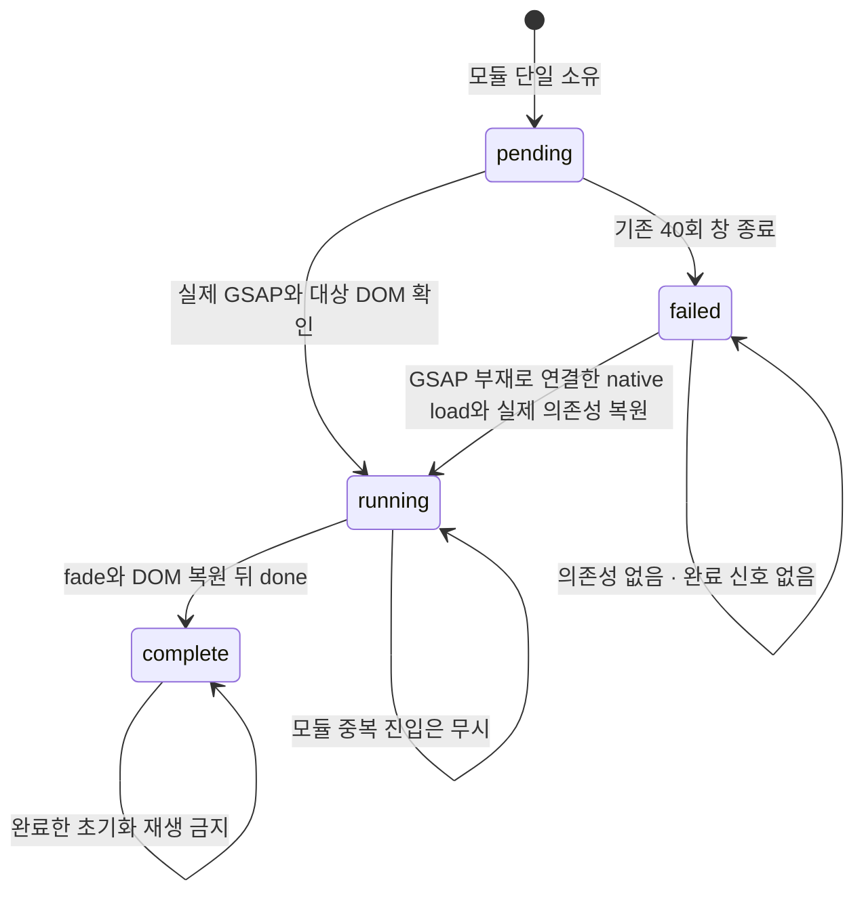

# D03/S1 — 실제 GSAP 복구 후 Hero 초기화 재개

2026-11-18 KST. 시작 HEAD `3f73eca`, 이전 검증 소스·검사 `c2a0b34`. AGENTS·관련 CLAUDE의 firstpaint/폰트/글로우/지그 보호 규칙과 최신 HANDOFF·16·firstpaint-final을 읽었다. 전용 Drive 표준과 최신 인계(수정일 11/16)도 읽었지만 현재 실행 범위와 기록은 사용자 지정 최신 GitHub 인계를 우선한다. 기존 완료 제품·검사·다른 작업자는 보존한다.

## 최종 판정 — Hero 복구 제품 검증 통과 / 원격 raw 보존 미완료

동결 소스·검사 **c4b2e5aa1344239b128b4ed6e6a27bcdbcdb3adf**의 별도 clone에서 **23단계 단일 연속 실행을 모두 통과**했다. 기존22단계를 유지하고 새26쌍/52실행을 같은 실행에 포함했다. 이전22단계 성공·부분성공·별도 smoke/portable 결과를 합산하지 않았다. 이후 전달은 문서·증거만 변경한다. [최종 대장](evidence/section1-recovery-final.json)이 판정/URL·SHA/복구/원격 보존 차단의 기준이다.

**이번에 제거한 의존성은 ‘실제 GSAP가 최초40회 재시도 창 안에 도착해야만 Hero가 시작되는 관계’다.** private started가 true로 붙잡힌 문제가 아니었다. module claim은 정상 중복 방지를 계속 소유하고, Section1 내부 pending/running/failed/complete가 실제 초기화 상태를 구분한다. 실패한 GSAP 대기는 native script load에만 연결되고 시작할 때 listener가 제거된다. 완료한 초기화는 다시 실행하지 않는다. 공개 head의 함수/ready class나 기존 이벤트 소비자 소유권은 이동하지 않았다.

제품 **b8c1e4e**는 Section1 한 파일만 변경했다. 이미 head gate가 열린 복구는 opacity를 다시0으로 내리지 않고, 불필요한 detach를 생략해 원래 반응형 타이포 문맥을 유지한다. 정상 최초 로드의 폰트 확인·detach·fade·1.5초hold·loop·ghost 복원과100ms/40회 제한은 보존했다. 새 runtime timer/observer/retry 계층·자산 요청·공개 파일 경로는 추가하지 않았다. 기존 E1/P3·제목 마킹d443254 및 다른 완료 코드도 그대로다.

GSAP 미로딩 경로의 상태는 다음과 같다. module claim은 아래 상태와 별개이며 head의 준비 완료도 Hero 완료와 별개다.

| 판정 | 근거 |
| --- | --- |
| 원본 실패→후보 실제 완료 | 소진 후 복원7쌍·head gate 뒤 복원3쌍,총10쌍에서 원본 claimtrue·ready/done0→후보 실제 ready/done 각1회·정상 화면/버튼/loop를 확인했다. 영구 실패3쌍은 미완료로 남는다 |
| 새 복구26쌍 | 1440/820/390,정상·소진 후 복구는PC/모바일 각3회/tablet1회. 지연·일시실패·head-ready 뒤 복원·영구실패는3크기 각각1회. 실제 GSAP 고정URL/본문·native 실패 및 실제40회 console 신호를 사용한다 |
| 반복 진입과 모션 | 시작 중 exact module bytes 통제 재평가와 완료 후 같은 실제URL 재진입을 구분했다. Hero 이벤트·loop1회,ghost0/원래부모 복원,실제fade완료→1490ms이상hold→loop,세시작폭의역전환·제목/버튼·line존재를 확인했다. 영구 실패를 성공으로 판정하지 않았다 |
| 정상·비대상 보존 | 후보S1을 실제 overlay한 Home을 포함해5페이지×3크기,기존1440 시작11경계,이전 firstpaint24쌍,CTA gap/border 각각108쌍·36통제,폼/메뉴/로더/품질을 같은23단계에 유지했다. 건강한 조건의 첫 화면 배치/타이포와 신규 복구 후 배치는 원본 정상 계약과 exact였다 |
| 첫 divider 보완 검사 | 동일 동결 소스의 별도6실행(3크기×정상/늦은복구)에서 실제 ScrollTrigger와 스크롤로 draw→erase→역스크롤 redraw·단일경로를 확인했다. 공식23단계 수에 더하지 않는다. 다른지그 전체모션으로 확대하지 않는다 |
| 실패 주입·개별 복구 | 같은 동결의 다른 clone에서 실제 원격 역패치b12377c를 적용하자 GSAP 복원 후 필요한 Hero 완료가 없어 검출됐다. 관련 JS/네트워크오류0,자기hunk복구 후 원래SHA/clean.1px도 별도 검출·복구했다 |
| 입력/실제 자산 | 원본8manifest·2,130body와 추가 입력의SHA를 다시 확인했다. 기존PNG33/응답286·mask·100px·threshold0.2·다른expected failure는 불변이다. 현재 실제Section1 CSS/JS와 GSAP3.12.2의 응답은 보관본문과 같고 공개10HTML·보호refs도 그대로다 |

### 보존한 실패와 검증 한계

첫23단계의tablet미수록폰트입력,마지막VM의표준Document API누락과그모형보완,초기후보의재숨김,검사의ghost오인,모바일detach문맥높이변화,parser지연중DOM없는snapshot,입력v1/v2의휴대성문제를 원시 상태로 보존했다. 같은 실패2회 뒤 제품 보정을 멈추고 실제 노드/공개 상태/본문 연결을 재진단했다. 다른 노드 덮어쓰기·허용값 완화·과거 응답을 최신bytes로 대체하는 보정은 없다.

새 입력v5는 원본의 공유 body 디렉터리까지 명시적으로 순회해13root·408고유본문을 보존한다. 새 경로에 독립 복원한 뒤 기준 해시와2쌍/4실행으로 실제 실패→복구를 확인했다. 이 결과는 로컬 휴대성 검사이고,새 환경의전체23단계·원격보존·물리실기기·운영 검증은 아니다. PNG와rAF/DOM 추적은 물리 고속영상이나 방문자 LCP/CWV가 아니다. 별도clone 자동 재실행을 독립된 사람의 전체구조 감사로 표현하지 않는다.

### 원격 원시 자료 — 미완료·별도 승인 필요

자동 승인 검토가 입력 아카이브의 Google Drive 외부 전송을 구체적인 payload 승인 부재 사유로 거절했다. **업로드는 수행되지 않았고 거절 후 다른 경로나 분할로 우회하지 않았다.** GitHub에는 source/tests·소유권·판정/핵심SHA·복구만 전달한다. 본문·PNG·전체로그는 로컬 전용이며 원격 보존을 완료로 표시하지 않는다. 전체 작업 완료 판정도 보류한다.

다음 두 파일은 업로드 승인용으로 구체화·로컬 읽기 검증한 자료다. 원시 결과 v2는 동일 SHA 내용만 아카이브 내부 hardlink로 중복을 줄였으며, 외부 symlink 없이 모든 원래 경로의 읽기 SHA를 확인했다. 목적지는 기존 성능 폴더 `1tKIoee51xS8Pbe5BDbGdhAwfXhsqtkzV`이며 공유 설정을 변경하지 않는다. 크기는 41712972B / 99078328B다.

- 입력: `HELIX-S1-Recovery-Replay-Inputs-v5-20261118.tar.gz` — SHA256 `18aae6719ac337390a148dba310aa5b0dd81a6f4178453424f6fb963c4853457`
- 원시 결과: `HELIX-S1-Recovery-Raw-Evidence-v2-20261118.tar.gz` — SHA256 `912af0dd39e874e6eef33b69ff9d9f5e3d6908e2a95252574de4eef91c2c63dd`

### 남은 위험과 다음 실행

1. **D03/S1 범위:** 실제 native GSAP 복원 경로의 격리 후보 통과다. 임의 구문/실행 예외,GSAP가 native script load 없이 전역에 삽입되는 경로,DOM 자체 누락 후 복구,다른firstpaint/전체section복제 경계는 해결했다고 하지 않는다. 첫 divider 외 다른 지그의 모든 모션 완료 경계도 이번 보완으로 대체하지 않는다. 영구 의존성 실패는 기능 복구가 아니며 failed 상태로 남는다.
2. **D02→D05:** 다음 독립 단위는 다른폼label/제목root의 실제 넘침과 CSS소유자다. 게시문구/합성입력 구분·원본실패·국소 후보·5×3보존을 먼저 확인한다. 다음 D05는 실제 소비 속성만 통제하며 기존 CTA 완료 속성은 반복하지 않는다. 미진단을 완료나 수정불필요로 바꾸지 않는다.
3. **D06:** 실제WebKit2227 실행파일·Safari/iOS/iPad 실기기가 없어 미검증이다. viewport제품을 바꾸지 않았다. 실제환경에서 회전/fixed/sticky/폼/카드를 확인해야 한다.
4. **전체/공개:** D04 일반HTTP200실행예외·구생산자·조용한pending·미래@main/cache 위험과 전체독립감사는 남는다. V0의 새 판별 근거가 없어 재개하지 않았고 U01도 보류했다.719는 E1/P3/현재D03없는 참고용이다. 현재공개소비자는작업소비자와 달라 단독공개이관/혼합호환성·운영 효과는 미검증이다.

복구는 **b12377c의 제품 diff만** 적용한다. main/staging 병합,공개head/pin/설정·Webflow Publish·운영 배포는 하지 않았다. 운영 사이트와 다른 작업자의 코드는 보존했다. 아래는 당시 계획·실패·체크포인트 이력이며 최신 판정은 이 절과 최종 대장을 따른다.

## 작업 개요와 범위

작업량 대. 현재 모델을 유지하고 높은 추론 강도·높은 예상 사용량으로 진행한다. 산출물은 원본 실제 실패 재현, 상태/소유자 추적, Section1의 최소 제품 변경, 별도 검사·역커밋, 새 동결 소스의 기존 22단계+복구 계약 단일 연속 실행과 인계다. 기존 승인 범위이며 중간 승인을 반복하지 않는다. main/staging 병합, 공개 head/pin/설정 및 Publish·운영 배포는 금지다.

## 수정 전 확인과 기술적 결정

- 작업장 clean·원격 HEAD 일치. 이전 runtime 및 핵심 증거 SHA, Section1 `cd54649e559fe939b754c5ea6af2652209be320d7e4078b9edaf0eb780f8d3f1`, 이전 firstpaint 검사 `dc5ca574f5b15abe816339e52c514ee1c10158aa1e91c65b5417e5248aa1a4da`를 대조했다. main `3c4f78d4`, staging `a074f455`, 참고 후보719도 그대로다. 공개 정식/스테이징 10 HTML은 이전 bytes와 같다.
- `__HELIX_SECTION1_LOADED__`는 모듈의 단일 소유권이다. GSAP 미로딩 때 `startSection1()`은 private `started`를 true로 만들기 **전에** false를 반환한다. 따라서 이 실패에서 private started가 붙잡힌다는 가설은 소스와 다르다.
- 100ms×40 재시도 종료 후 interval은 제거된다. 모듈 소유권은 남고 실제 의존성 로드 뒤 재진입 연결이 없어 ready/done이 생산되지 않는다. 모듈 guard를 무조건 지우거나 재시도 상한을 늘리지 않는다.
- 공개 head는 자기 준비 조건과 최종 ready class를 소유한다. coming-soon의 ready/done 소비 및 기존 fallback 공개는 Hero 완료가 아니다. sections는 자기 정상 재진입으로 복구할 수 있고 `helix-s1-done`을 받아 재측정한다. 이 소비자와 공개 head는 수정 대상이 아니다.
- 가설은 **기존 40회 창을 그대로 유지하면서**, 종료 시 Section1이 자기 미완료 상태와 실제 script load를 연결하고 초기화 시작 시 연결을 철회하는 것이다. 정상 시작/실행/완료는 재실행하지 않는다. 새 timer·observer·범용 복구 계층은 만들지 않는다. 현재 DOM과 실제 GSAP가 없는 실패는 완료로 바꾸지 않는다.

## 검증·복구 계약

이전 정확한 GSAP URL/본문과 40회 실제 console 실패 신호를 재사용한다. 원본 실패→후보의 실제 ready·done, ghost 복원과 원래 부모/타이포·배치, fade→1.5초 hold→loop를 확인한다. PC/태블릿/모바일에서 정상·지연·일시 실패·소진 후 복원·영구 실패·중복 진입과 역전환을 나눈다. head가 먼저 열린 뒤 복구하는 경계도 따로 관찰한다. 정상 PC/모바일은 최소 3회 짝비교한다.

기존 22단계와 5×3·CTA108/36·heading/지그/메뉴/폼 계약을 보존하고 새 단위를 추가한다. 과거 성공을 합산하지 않는다. 이전 firstpaint의 미해결 분류는 원본에 남기되 후보에서는 실제 완료의 정방향 계약으로 승격해야 한다. 기준 PNG·mask·100px·threshold0.2·다른 expected failure는 유지한다. 같은 실패 2회면 덮어쓰기를 멈추고 입력/소유자를 재진단한다.

제품과 도구는 별도 커밋, 원인별 역커밋은 별도 recovery 브랜치에 보존한다. 새 clone에 실제 역패치와 1px 오류를 개별 주입해 검출 후 해당 hunk만 복구한다. 원시 증거는 새 `/workspace/artifacts/helix-s1-recovery-20261118`에 보존하며 기존 자료를 덮지 않는다. 원격 보존 여부는 별도 판정하고 로컬 전용 자료를 원격 전달 완료로 표시하지 않는다.

## 현재 상태·다음 단계

기존 입력을 무수정 소스에 재실행 중이다. 아직 제품 수정/복구 완료 판정은 아니다. Hero 단위가 실제 통과한 뒤 D02 다른 label·제목→D05 실제 소비 속성→실환경 D06→전체 독립 감사의 조건을 평가한다. D04 잔여·V0/U01 보류와 719 참고용 경계는 유지한다.

참고: [최신 인계](HANDOFF.md), [이전 소유 그래프·실패](16-firstpaint-hero.md), [이전 동결 대장](evidence/firstpaint-final.json).

## 원본 재현과 복구 후보의 경계 진단

이전 검사 그대로 PC/모바일 원본·대조 4실행에서 실제 40회 실패 신호→같은 실제 GSAP 복원→section 버튼1/loop 및 Hero claimtrue·ready/done0을 다시 확인했다. 원시 `original-reproduction`과 이전 핵심 증거 SHA가 일치한다. 최초 국소 후보는 PC/모바일에서 실제 Hero 완료를 만들었다.

추가 after-head 경계에서는 기존 section도 재시도 창이 끝난 원본 실패가 나와 별도 분류했다. 첫 후보는 초기 opacity0 대기로 부분 빈 화면을 만들었고, 두 번의 시각 검사 실패 뒤 제품 보정을 멈추고 DOM/원시 프레임을 재진단했다. 검사 첫 선택자가 detach 중 숨은 ghost를 읽는 문제와 ready class≠실제 노출을 분리했다. ghost를 제외한 실제 노드로 검사를 강화했다. 또한 모바일의 실제 슬로건 높이가 detach 문맥에서 142.5→139.21875→142.5로 변하는 것을 관찰했다.

제품은 40회 종료 뒤 실제 script load를 기다리는 Section1 내부 실패 상태만 추가한다. 시작 시 listener를 철회하고 running/complete는 재실행하지 않는다. 공개 head가 이미 gate를 연 실패 복구에서는 opacity1을 유지하고 불필요한 detach를 생략해 노출/타이포 문맥을 보존한다. 정상 최초 로드의 값·폰트·detach·모션·hold/loop와 timer 횟수는 그대로다. 기존 head나 section 소비자는 바꾸지 않는다. 검사 원문·원본 실패·후보 실패와 잘못된 검사 예상은 서로 다른 출력 경로에 보존하며 통과 결과에 합산하지 않는다.

## 원격 보존 차단 — 완료로 승격하지 않음

기존 불변 입력 11 root를 SHA 동일 본문 기준으로만 중복 저장을 줄인 재현 아카이브를 준비했다. 정확한 URL/manifest는 유지했고 새 응답·alias로 바꾸지 않았다. `HELIX-S1-Recovery-Replay-Inputs-20261118.tar.gz`는 35,690,502B, SHA256 `648ce687d04dcc79dc595b92647047ce6fa8f61554c6216ea48eadfd0d3706e2`다. 전용 성능 Drive 폴더 업로드를 자동 승인 검토가 거절했다. 검토 사유는 내부 재현 입력/응답 본문의 대용량 외부 전송에 구체적인 payload 승인이 없다는 것이다. 업로드되지 않았으며 분할·다른 경로로 우회하지 않는다.

코드/격리 검사/복구/GitHub 문서 전달은 계속하되 원시 자료 원격 보존은 **미완료·별도 승인 필요**로 남긴다. 사용자의 ‘원격 보존이 안 된 자료는 완료로 기록하지 않음’을 적용한다. 최종 원시 결과 묶음까지 구체화한 뒤 정확한 파일·크기·SHA·목적지로 승인 요청한다. 원격 raw가 없는 상태를 전체 작업 완료나 깨끗한 다른 머신의 완전 재현 완료로 보고하지 않는다.

재현 아카이브 읽기 검증에서 초판 일부 body가 외부 symlink로 저장된 문제를 발견했다. 초판과 실패를 보존하고 본문을 실체화한 별도 v2를 만들었다. 11 root·398 본문과 전체 manifest의 로컬 SHA 읽기 검증을 통과했다. v2는 41,216,698B, SHA256 `b489c73e54e7b8267aa1f00847c7b68464d28dceff795d0fc57a505eba34eb13`다. 거절 이후 재업로드는 시도하지 않았다.

## 소스·검사·복구 분리 체크포인트

제품 **b8c1e4e95a263604c597efa906af3c6cb0e59647**은 Section1 한 파일만 바꾼다. 검사 **52e85047ab24a57b4910fdf111a8b3666472fc12**는 원본 GSAP 소진 실패를 유지하고 후보의 실제 완료를 요구한다. 새 26쌍에는 PC/모바일 정상·소진 후 복구 각 3회, tablet 각 1회와 모든 크기의 지연/일시실패/이미 열린 head 뒤 복구/영구실패를 포함한다. 총52 실행이며 native 복원과 exact module bytes의 시작 중 재평가, 완료 뒤 실제 같은 URL 재진입을 구분한다.

역커밋 **b12377cb6825557838f951dcad284dd6754cdc40** (`recovery/helix-section1-recovery-20261118`)은 제품의 해당 diff만 되돌린다. 전체 recovery 브랜치 스냅샷으로 대체하지 않는다. 이후 새 clone에서 같은 동결 소스의 실제 역패치/1px 개별 검출·복구와 23단계 단일 연속 실행을 수행한다. 아직 최종 통합 통과나 원격 raw 보존 완료로 판정하지 않는다.

## 동결 실행·복구·입력 복원 체크포인트

동결 소스·검사 **bcfe51e4bc430b83964a893175a106c64b8cde47**의 새 clone에서 기존22단계+복구26쌍을 포함한23단계 단일 연속 검증을 시작했다. 기존 PNG33·응답286 integrity,5페이지×3크기(실제 Home 후보 Section1 포함),상호작용,heading 모션까지 통과했고 전체는 아직 미완료다. 별도 clone에서 실제 원격 역패치 b12377c를 넣자 native GSAP 복원 후 필요한 Hero 완료를 기다리다 실패했다. 관련 JS/네트워크 오류는0이었다. 자기 hunk만 복구해 원래 SHA로 돌렸고1px도 검출·복구해 clean을 확인했다.

입력 v2의 SHA 읽기 검증은 통과했지만 실제 새 경로 재생은 HTML body 연결 누락으로 중단됐다. 원인은 `rglob`가 공유 `bodies` 디렉터리 symlink를 순회하지 않은 것이다. 제품이나 검사 허용값을 바꾸지 않고 body root를 명시적으로 순회한 별도 v3를 만들었다. 원본8 root의2,130개 파일 연결과 전체11 root를 보존했고, SHA로 중복 저장을 줄인 실제398본문을 포함한다. 새 경로에 복원한 뒤 기준 PNG33/응답286과 실제 실패/복구2쌍(4실행)을 오프라인으로 통과했다. 이는 로컬 복원 검증이며 전체23단계나 원격 전달 완료가 아니다. v1/v2와 원시 실패도 보존했다.

최종 승인 검토 대상 입력은 `HELIX-S1-Recovery-Replay-Inputs-v3-20261118.tar.gz`,41,215,086B,SHA256 `07688babf7b8ecb1b60c7864440da978a94b719866989e244c88598a81384dad`다. 기존 거절 뒤 업로드 재시도는 없다. 결과 raw 묶음도 최종 검사 후 구체화하며 원격 보존은 미완료다.

소비자 전체 검색에서 coming-soon,sections 외 실제 `home/global/scroll-hint.js`와 `home/section-divider/divider.js`도 done을 소비한다. 각자의 기존 다중 호출 guard·fallback·지연 재측정은 유지한다. 이번에 소유권을 이동하거나 그 파일을 수정하지 않는다.

## 첫 동결23단계 중단 — 신규 tablet 입력

첫 `final-continuous`는 integrity/scope/interactions/heading/firstpaint24쌍까지5단계를통과하고,new Hero 단위11쌍뒤tablet820 GSAP 지연의원본에서중단했다. 새조건이정확한미수록TypekitURL5개를요청했고 strict network/JS오류0계약이거절했다. 실제Hero완료/loop가있어도자산오류를무시해통과시키지않았다. source/tests `bcfe51e`·제품b8c1e4e·기준PNG/허용값은유지한다.

새tablet6조건의수집진단은명시적diagnosticOnly/passfalse이며기능assert는유지한다. 미수록literalTypekit GET만실제Chrome요청헤더로확보하고수집시각/URL/응답SHA를남긴다. 기존URL/본문을대체하거나state/chunks/order를alias로정규화하지않는다. 새입력정적검증후다른출력경로에서23단계를처음부터재실행하며이전5단계/11쌍성공을합산하지않는다. v3재현아카이브는이새tablet입력을포함하지않으므로최종승인payload로아직확정하지않는다. 거절후어떤원시파일도재업로드하지않았다.

## 두 번째 입력 실패와 전체 범위 재진단

정적사전검사의PC1440 GSAP지연 원본에서도다른literal청크URL5개가미수록으로거절됐다. 같은종류실패2회뒤추가제품보정을중단했고,진행중이던두번째23단계는해당격리검사process tree만식별해중단했다. 일부단계나정상완료신호가있어도전체통과로올리지않았다. 원인재진단의실제fontkit은 `yun6zxv.js`,SHA `16b3016a8509e8f5bb1326e2fa568aeff4ef04cc597c69f3ef1040cee620fa54`이며timer/DOM관찰·문자코드/청크요청생성이있다. URI의state/chunks/order는parser/font스캔배치에따라달라질수있다. 병행실행이유일한원인이라고단정하지않는다.

초기수집기가알려진font에도추가route.fallback을거쳐시점을바꿀수있는점을확인했다. 제품/브라우저/CSS/검사기준은유지하고,수집기는미수록URI에만일하도록별도진단판을만들었다. 전체26쌍진단및세크기지연각3회인9쌍진단은기능assert를유지한diagnosticOnly/passfalse로보존했다. 새로운실제GET은추가발생하지않았으며,앞서실패에서관측한PC literalURL5개는실제응답/SHA를별도로확보했다. 이전URL/본문의교체·정규화alias는없다.

이제수집기없는정식검사로지연9쌍을확인한뒤단독browser로23단계를처음부터다시실행한다. 기존부분성공은합산하지않는다. 이재진단뒤에도새미수록실패가반복되면새임시보정을쌓지않고검증후보/검증체계미완료로남긴다. 원격raw는여전히미완료이고,추가입력까지포함하는최종승인아카이브는검증후확정한다.

## 정식 정적 지연9쌍 통과와 세 번째 연속 실행

수집기를뺀frozen `bcfe51e` 정식검사로1440/820/390의GSAP지연각3회,총9쌍/18실행을통과했다. 모든실행오프라인forwarded0·network/JS오류0,실제Hero완료와글꼴/배치/hold/loop를확인했다. source/tests·기존입력은그대로이고추가한정확URI는tablet5/PC5다. 이사전성공을전체23단계에합산하지않는다.

동일소스의 `final-continuous-v3`를새출력경로에서처음부터단독browser로시작했다. 환경은 `env-v3.sh`이고추가입력은기존20개+tablet5개+PC5개다. CSS/브라우저설정/기준PNG/mask/허용값/expected failure의변경은없다. 원격raw보존은여전히미완료이며승인없는업로드재시도는없다. 이후도문서/증거만갱신하고새제품/검사소스를섞지않는다.

## 세 번째 연속 실행의 Hero26쌍 완료 체크포인트

동결 `bcfe51e`의 `final-continuous-v3` 안에서새복구26쌍/52실행을모두완료했다. 소진후복원7쌍·head gate뒤복원3쌍의총10쌍은원본Hero이벤트0→후보실제ready/done각1·정상콘텐츠/글꼴/배치/loop다. 영구실패3쌍은미완료로유지했다. 실제원본빈Hero와후보복구PNG도확인했으며정상/실패/복구이미지의기존헤더RGB영역도동일했다. 기준PNG나mask를수정한것이아닌추가분석이다.

같은연속실행에서기존firstpaint24쌍·CTA gap/border각108쌍/36통제·form intro까지통과했다. 전체23단계는아직진행중이며새Hero단위나앞선성공만으로전체통합/구조안정화/원격raw완료를선언하지않는다. source/tests/기준과추가입력은동결상태다.

## 마지막 VM 검사 모형 보완과 재동결

`final-continuous-v3`는23단계중앞선22개를모두통과하고마지막home-loading의VM테스트에서실패했다. 실제브라우저26쌍/52실행을포함한제품동작오류가아니라가짜document에표준 `removeEventListener`가없어TypeError가난것이다. 제품b8c1e4e는그대로이며가드/폰트/배치/정책/기준도바꾸지않는다.

검사전용 **c4b2e5aa1344239b128b4ed6e6a27bcdbcdb3adf**는fixture의기존event-list모형에표준listener제거만추가한다. 기존assert/기대값/허용조건은한줄도바꾸지않았다. Home loading6그룹과품질9그룹의빠른전체검사가통과했다. 빠른VM검사를초기에먼저확인하지못해재실행이늘어난실행순서오류도기록한다. 앞으로새runtime API를추가하면이빠른검사를먼저실행한다.

소스·검사는이 **c4b2e5a**로다시동결한다. 새clone `/workspace/helix-s1-recovery-final-v4-20261118`에서 `final-continuous-v4`23단계를처음부터연속실행한다. 이전22단계성공과새VM성공을합산하지않는다. 기존BCFE의정적지연9쌍은동일한browser검사/제품바이트의입력완전성근거로만보존한다. 최종통합판정은새동결의실제23단계한실행으로만한다. 제품/검사와원시입력/실패는모두보존한다.
