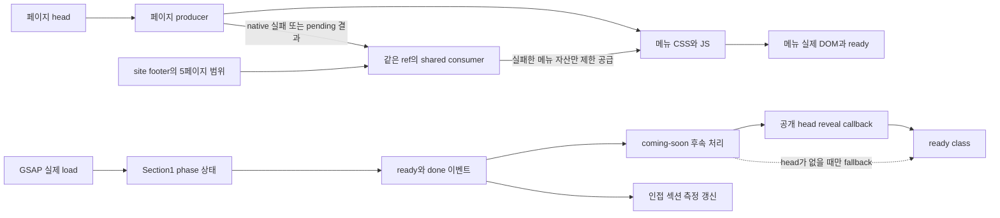

# 외부 독립 검토자용 읽기 전용 자료

기준 `81da752`, 제품 `21acccb`, QA `b6685f0`. 이 묶음은 **구현자가 준비한 자료이며 외부 감사 결과가 아니다.** 외부 검토자·검토 일시·서명은 미배정/미기록이다. 전체 구조 안정화 및 공개 적용을 승인하지 않는다.

## 읽기 순서

1. [고정 문서·검사 코드·입력·결과 대장](manifest.json)의 `fixedBasisDocuments`와 `testCode`를 commit 고정 URL로 읽는다. 현재 작업 브랜치의 움직이는 HEAD를 검사 소스로 대체하지 않는다.
2. [33개 파일 전후 비교](file-differences.json)를 읽는다. 기본14 / staging Home13 / Services6이며 GitHub 전체 비교 파일 집합과 일치한다. 각 원본/후보의 Git blob·SHA256·실제 URL·소비자·정확한 로컬 diff SHA를 기록했다.
3. [10개 페이지/환경 소비 관계](producer-consumers.json)를 읽는다. 5페이지×2환경의 producer/shared ref 일치와 실제 전후 요청 URL·SHA를 연결한다. 3크기 결과는 기존 동결v3에 있으며 새로 실행한 결과가 아니다.
4. [여섯 설정 계약](../../proposals/functional-rollback-20261120/manifest.json)과 각 patch를 읽는다. **현재 저장 원본 → 복구안의 patch가 아니다.** 미적용 현재 후보669/62의 after → 기능 복구 cohort이며, 전후 SHA가 다르면 적용하면 안 된다. 부분 적용 불가, 여섯 SHA/producer/shared 일치 전 Publish 보류다.
5. [최종 v3 결과](../../evidence/functional-rollback-final.json), [기존 raw 영수증](../../evidence/functional-rollback-raw-receipt.json), [새 About 조사](../../evidence/about820-readonly-investigation.json), [미게시 확인 범위](../../evidence/unpublished-scope-readonly.json)를 읽고 [검토표](checklist.md)를 **다른 검토자가 직접** 작성한다.

## 원본 비교에서 혼동하면 안 되는 것

- 원본 mirror 세 개는 과거 재현용이며 기능 원복 대상으로 사용하면 안 된다. 메뉴/예약창 잠금과2회JS실패 메뉴0이 과거에 확인됐다.
- `file-differences.json.before`는 원본 mirror의 파일 tree 기준이다. `effectiveOriginalConsumerSamples`는 기존 동결 검사에 사용한 실제 원본 요청 owner 기준이다. **Services의 global/bootstrap.js에서 두 기준이 다르다.** 원본 Services tree 속 shared 파일을 당시 활성 shared로 오인하지 않는다. 보존된 실제 원본 Services는 producer ba91와 shared main3c의 역할을 구분한다.
- source/normal 영수증에 같은 global/bootstrap URL이 두 번 있는 것은 QA `adoption-blockers.cjs:217`이 정상 조작 후 shared 진입을 의도적으로 한 번 더 주입한 결과다. 이를 정상 운영의 중복 전송 장애로 오인하지 않는다.
- Services shared bootstrap/CSS diff는 메뉴 관련 줄만 포함하지 않는다. 기존 코드 재사용으로 생긴 경로별 기능도 직접 검토한다. 모든 내비게이션/SEO 의미의 동등성은 새로 검증되지 않았다.
- 기본/Home 복구 tree는 각각 기존669/62와 같다. 별도 ref의 고정 정상 기준점이며 공유 구현 자체의 결함을 해결하는 대체 구현은 아니다.

## 책임과 확인할 계약

| 경계 | 생산자/소비자 | 검토 증거 |
|---|---|---|
| 메뉴 잠금 | hamburger.js가 html/body의 자기 class만 제어, hamburger.css가 문서 root 잠금 | root-locks 두환경30, About1440 두 해제 순서, 메뉴 inverse/restore |
| 예약창 잠금 | floating-cta.js의 실제 modal is-open 상태를 floating-cta.css의 html:has가 소비 | nonzero scrollY/wheel/Escape/초점, 폼 inverse/restore |
| 메뉴 자산 | 페이지 producer의 native 실패 소유권 해제 + shared의 native/pending 결과 인계 | 실제40 native복구, 엄격50영수증,1회2요청/2회3요청 동일ref |
| GSAP/Hero | Section1 모듈 점유와 phase pending/failed/running/complete, native GSAP 복원 후 재진입 | 실제36 중30완료/영구미완료6, 기존26쌍; 완료 이벤트와 ghost/hold/loop |
| firstpaint | 현재 공개head의 reveal/ready class, coming-soon의 호출과 head-없음 fallback | 공개HTML SHA, QA24경계; head 소유권 변경은 미수행 |
| heading/viewport | coming-soon의 모든 heading hook 표기 후 Hero/인접성 검사 | 숨겨진 복제DOM·폭 전환·역전환 기존검사 |
| D02/D05 | 기존 CSS 소스 byte 보존과 component root/variant 계약 | consent/intro/label15, CTA108쌍/36편집; U01 미이관 |

## 읽기 전용 접근과 원시 자료

GitHub에서는 고정 commit의 소스·비교·파생 대장만 읽는다. 저장소 권한/공개 설정은 변경하지 않았다. 로컬 raw는 `/workspace/artifacts/helix-functional-rollback-20261120`와 이번 `/workspace/artifacts/helix-independent-audit-prep-20261120`에 있으며 **외부 업로드하지 않는다**. 같은 작업공간에 대한 읽기 권한이 없는 외부 검토자는 소스/메타데이터 검토만 가능하고, 전체 시각·재현 감사는 보류해야 한다.

완전한 기존25 재현에는 새 recovery 입력20뿐 아니라 `/workspace/helix-s1-portable-inputs-v5-20261118`의13개 root·pages mapping·production corpus와 정확한 Debian13/x64·Playwright1.57·기준Chromium 환경이 필요하다. WebKit은 설치돼 있지 않다. `manifest.json.testInputs`에 실제 경로·SHA를 기록했다.

자료 읽기와 SHA 비교는 원본 디렉터리에 파일을 만들지 않는다. 승인된 별도 재현을 한다면 출력은 별도 작업본/새 경로에만 쓰고, 제품·기준PNG·mask·허용오차·기존raw를 수정하지 않는다. 이 자료에는 자동 실행/Publish/권한 변경 동작이 없다. 외부 검토를 완료했다는 체크는 구현자가 대신 채우지 않는다.

이번 신규 raw 폴더는 해시 목록 작성 후 자체 파일0444/폴더0555로 읽기 전용 동결한다. 기존 원본 raw의 파일권한은 바꾸지 않는다. 외부 검토의 접근 권한을 새로 부여하거나 외부 전송하지 않았으며, 실제 검토는 기존 허용된 읽기 경로에서 수행해야 한다.
